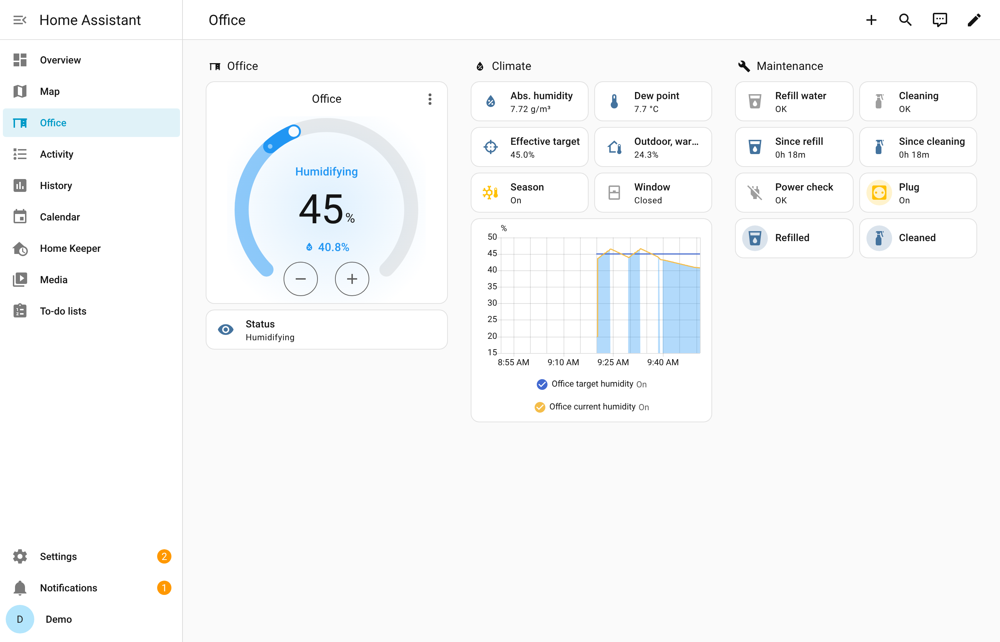
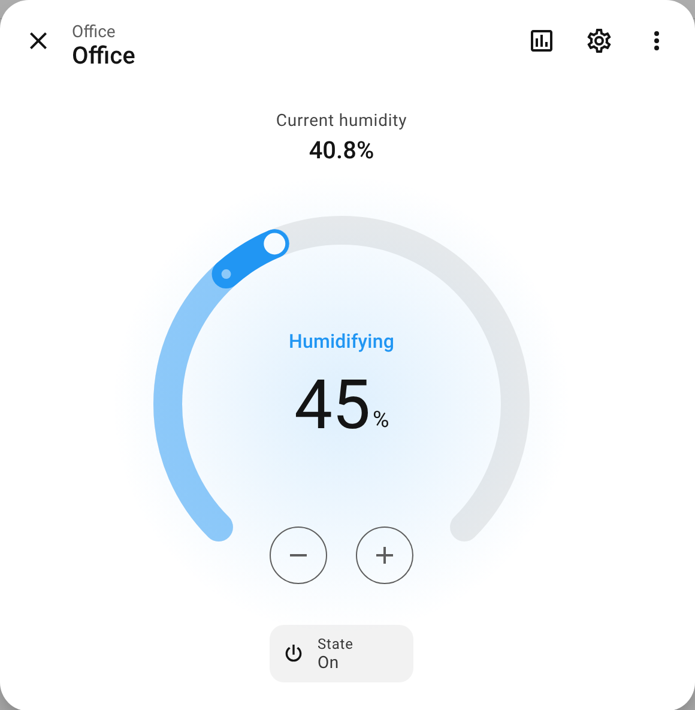
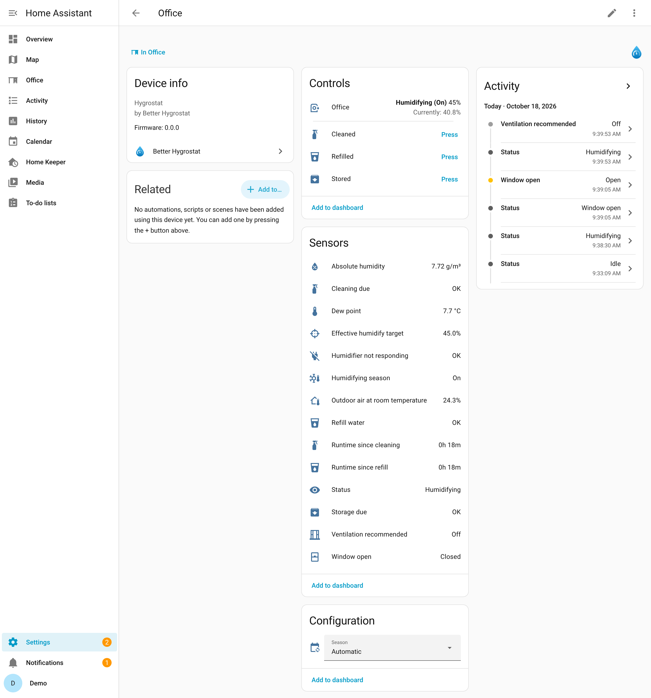
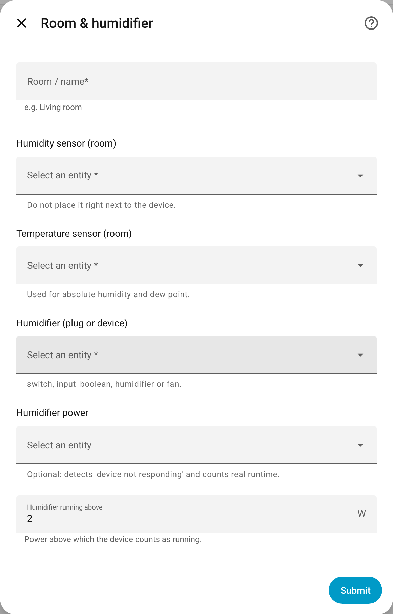
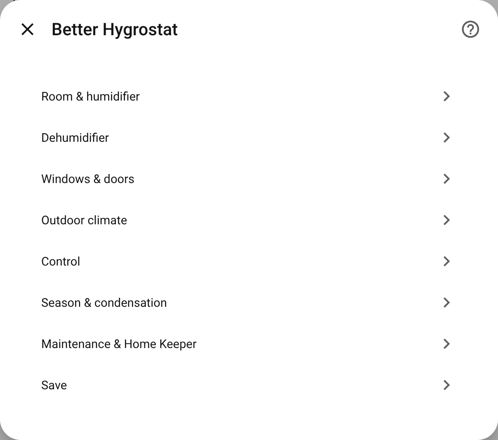
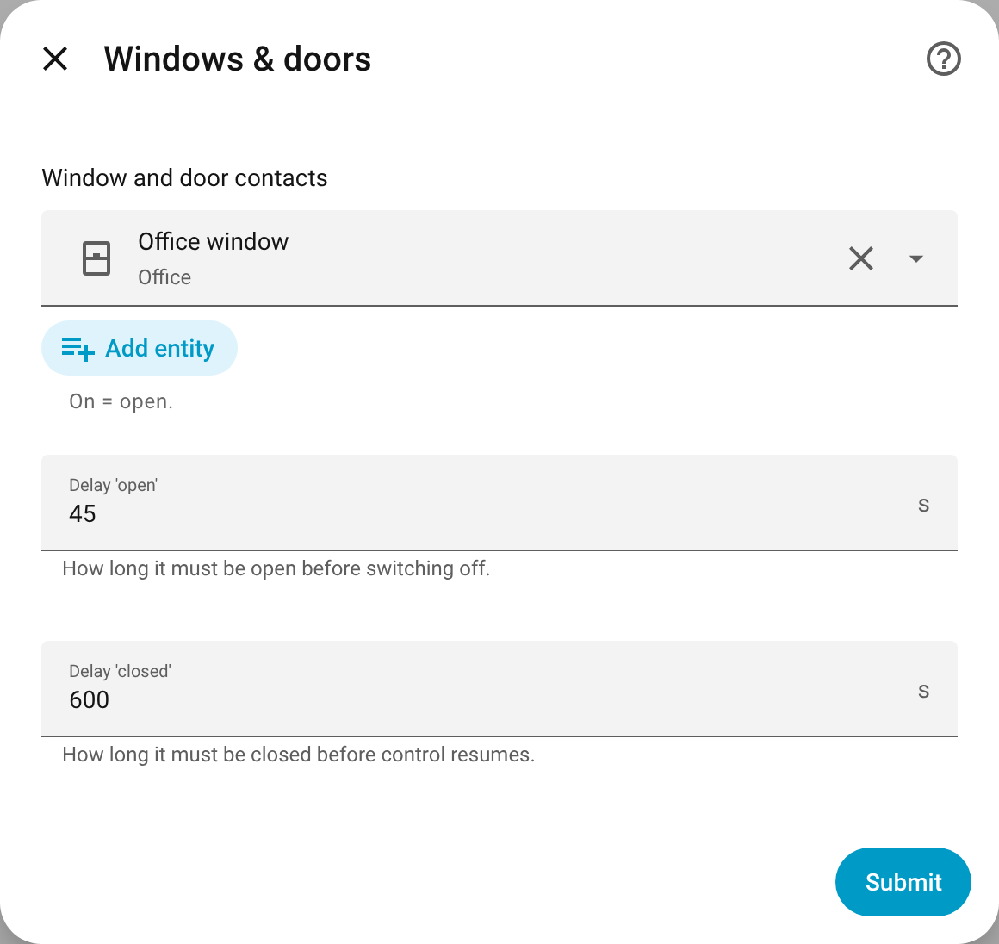
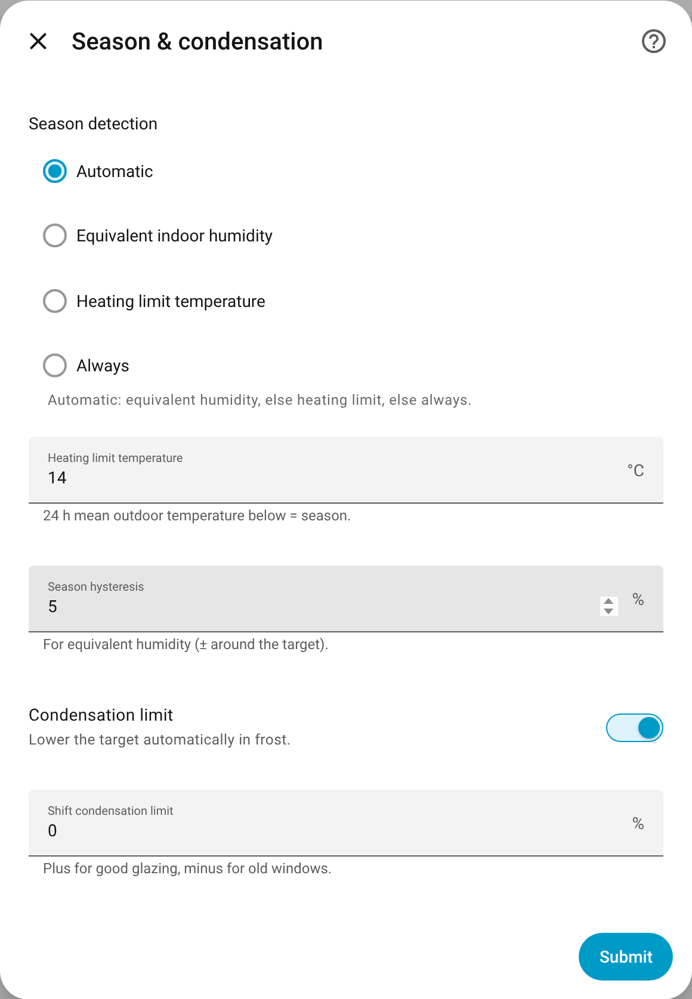
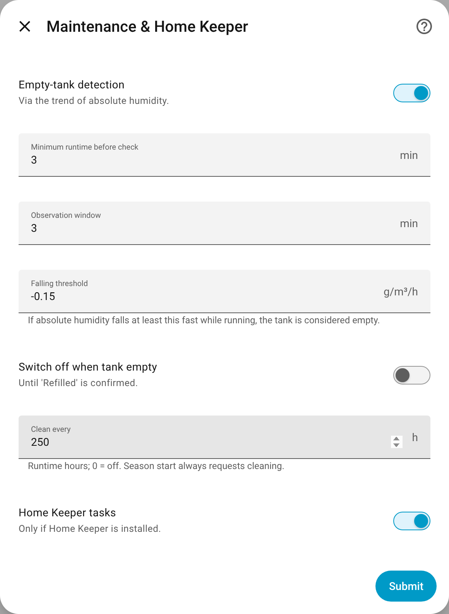
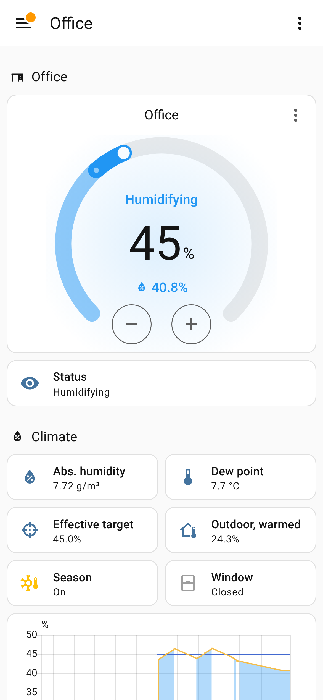

# Better Hygrostat

One smart hygrostat per room: your room's humidity sensor and the plugs of a humidifier and, optionally, a dehumidifier, combined into a single Home Assistant entity that knows about windows, the season and maintenance.

Better Hygrostat is a custom integration in the spirit of Better Thermostat. Each room gets one `humidifier` entity that switches the right device, stops when a window is open, humidifies only when the outdoor climate calls for it and tells you when the tank is empty or the device needs cleaning.

- **Humidifier and dehumidifier:** one entity controls both, with a dead band between them, a changeover lock and never both at once.
- **Windows and doors:** switches off shortly after a window opens and resumes once it has been closed for a while.
- **Season from the outdoor climate:** humidifies only when outdoor air, warmed to room temperature, would be too dry, so it stays off in summer by itself.
- **Condensation limit:** lowers the target in frost so windows and thermal bridges stay dry.
- **Empty tank detection:** from the trend of absolute humidity while the humidifier runs, without a float switch.
- **Power check:** with a power-metering plug it notices a device that is switched on but not running, and a dehumidifier that stops because its tank is full.
- **Maintenance:** cleaning after runtime hours and at every season start, storage at season end, refill when the tank runs dry.
- **[Home Keeper](https://github.com/prestomation/ha-home-keeper) (optional):** an appliance per device and a task for every maintenance case, kept in sync in both directions.

## Screenshots

Taken from a local Home Assistant instance: template sensors stand in for the room and outdoor sensors, the humidifier plug is a template switch, and a small script lets the humidity follow the plug ([how](scripts/screenshots/README.md)).

**Dashboard:** the room hygrostat, what it bases its decisions on and the maintenance state. The history shows the humidifier cycling, a window being opened and, at the end, the tank running dry.



**Room hygrostat:** target humidity, current humidity and what it is doing right now. Blue areas: the humidifier runs.



**Device page:** status, climate values, problems and maintenance buttons.



**Home Keeper:** the refill task, managed by Better Hygrostat, on the humidifier's appliance.


**Setup:** one room per entry; the first step asks for the room's sensors and the humidifier.



**Settings:** every part can be changed later via **Configure**.

| Menu | Windows & doors | Season & condensation | Maintenance |
|---|---|---|---|
|  |  |  |  |

**Mobile:**



> **Status:** early development.

## Installation

Requires Home Assistant 2026.10 or newer.

### HACS

[](https://my.home-assistant.io/redirect/hacs_repository/?owner=financelurker&repository=ha-better-hygrostat&category=integration)

1. Click the button above. It opens the repository in HACS and adds it as a custom repository if needed.
2. Select **Download** and restart Home Assistant.

Without the button: HACS → ⋮ → **Custom repositories** → add `https://github.com/financelurker/ha-better-hygrostat` as type *Integration*.

### Manual

1. Copy `custom_components/better_hygrostat` into `config/custom_components/`.
2. Restart Home Assistant.

A manual copy can be switched to HACS later: download it in HACS over the existing folder and restart. Rooms, entities, history and counters stay as they are.

## Setup

[](https://my.home-assistant.io/redirect/config_flow_start/?domain=better_hygrostat)

Settings → Devices & services → Add integration → **Better Hygrostat**, once per room.

| Step | What you enter |
|---|---|
| **Room & humidifier** | Name, room humidity and temperature sensors, the humidifier (plug or device) and optionally its power sensor. |
| **Dehumidifier** | Optional: plug or device, power sensor, tank-full sensor. |
| **Windows & doors** | Contact sensors (on = open) and the delays for open and closed. |
| **Outdoor climate** | Outdoor temperature and humidity, or a weather entity as a fallback. Optional, but needed for season and condensation limit. |

Later, via **Configure**, also: targets and tolerances, minimum on/off times, changeover lock, season method, condensation limit, tank detection, cleaning interval and Home Keeper.

> **Before you start:** every plug belongs to exactly one controller. Delete a Generic Hygrostat helper and disable automations or blueprints that switch the same plug (Settings → Entities → plug → **Related** shows them). A device on a plug must start by itself when it gets power.

## How it decides

### Control

| | Default |
|---|---|
| Humidify **on** below | target − 2 % |
| Humidify **off** from | target + 2 % |
| Dehumidify **on** above | *dehumidify above* + 2 % |
| Dehumidify **off** from | *dehumidify above* − 2 % |
| Dead band between target and *dehumidify above* | at least 5 % |
| Changeover lock between the two directions | 30 min |
| Minimum on / off time | 10 min each |
| Sensor counts as failed after | 120 min without an update (0 = never) |

- **Locks** (window open, sensor failed, season over, mode) switch off at once, also within the minimum on time. Switching on always waits for the minimum off time.
- **Hygrostat off** switches the devices off once and then leaves them alone, so you can run them by hand.
- With a dehumidifier the entity offers the modes **auto**, **humidify** and **dehumidify**, and a number entity for *dehumidify above*.
- A smart humidifier (a `humidifier` entity) is switched on and off, and its own target is set to its maximum (a dehumidifier: minimum), so only one controller controls.

### Windows and doors

Off after a contact has been open for **45 s**, back to normal after all contacts have been closed for **10 min**. Short trips through the balcony door change nothing, and after airing the room gets time before the humidifier starts again.

### Season

| Method | Season active while … |
|---|---|
| **Equivalent humidity** (automatic with outdoor temperature and humidity) | the 24 h mean of the outdoor air's humidity at room temperature is below target − 5 %; it ends above target + 5 % |
| **Heating limit** (automatic with outdoor temperature only) | the 24 h mean outdoor temperature is below 14 °C |
| **Always** (automatic without outdoor sensors) | always |

The **Season** select overrides it: automatic, always active or inactive.

Why equivalent humidity: 5 °C and 80 % outside is only about 28 % once that air is warmed to 21 °C, while 20 °C and 60 % stays at about 56 %. Heating dries the room, and this number shows when it does.

### Condensation limit

In frost the effective target is capped, so humidity does not condense on windows and thermal bridges:

| Outdoor | max. target |
|---|---|
| ≥ 5 °C | 50 % |
| 0 °C | 45 % |
| −5 °C | 40 % |
| −10 °C | 35 % |
| ≤ −20 °C | 30 % |

Values in between are interpolated. *Shift condensation limit* moves the table up for good glazing or down for old windows.

**Ventilation recommended** turns on when the room is too humid and the outdoor air is clearly drier (absolute humidity at least 1 g/m³ lower): airing then dries the room for free.

## Maintenance

| Problem | Detected when … | Resolved by |
|---|---|---|
| **Refill water** | the humidifier has run for 60 min, all windows are closed and the **absolute** humidity has fallen by at least 0.15 g/m³/h over 90 min | button *Refilled*, Home Keeper, or automatically once humidity clearly rises while running |
| **Cleaning due** | after 250 runtime hours and at every season start | button *Cleaned* or Home Keeper |
| **Storage due** | at season end, if the humidifier ran for at least 1 h in the season | button *Stored*, Home Keeper, or a new season start |
| **Humidifier not responding** | the plug is on but draws no power for 3 min | automatically, once power flows again |
| **Dehumidifier tank full** | the dehumidifier drew power and suddenly stops, or its tank sensor reports full | automatically when it runs again, or button |
| **Dehumidifier not responding** | the plug is on and it never draws power | automatically |

- **Absolute, not relative humidity:** when the room warms by 2 °C, relative humidity drops by about 6 points without any water missing. Absolute humidity stays the same.
- **Falling, not just not rising:** a device that is too weak levels off below the target. An empty tank shows as humidity that falls although the humidifier runs.
- **Calibrate** with the sensors *Absolute humidity* and *Status* (attribute `tank_slope_g_m3_h`) during the first weeks. False alarms: make the threshold more negative or the window longer. Late detection: move the threshold towards 0.
- *Runtime since refill* learns how long a tank lasts (attribute `typical_tank_runtime_h`).
- **Optionally switch off** when the tank is empty, until *Refilled* is confirmed.

## Home Keeper

With [Home Keeper](https://github.com/prestomation/ha-home-keeper) installed and the option *Home Keeper tasks* on (default):

- **Appliances:** one per device, for example *Office: Humidifier* and *Office: Dehumidifier*, as virtual devices managed by Better Hygrostat, linked to the plug and the room. Name, manufacturer, model, manual, cost and parts are yours to edit; Better Hygrostat changes none of them.
- **Tasks:** every problem from the table above becomes a triggered task on the matching appliance. A task appears the first time its problem occurs and is then armed and cleared again, so its history accumulates.
- **Both directions:** completing a task in Home Keeper resolves the problem here and resets its counter (for example *Runtime since refill*); resolving it here (button or automatically) completes the task.
- **Consumables:** add the hygiene additive to the humidifier's appliance as a *consumable* part with stock and pick it as *Linked consumable* on the cleaning task. Every completed cleaning then takes one off the stock, and Home Keeper can create a buy task when you run low.
- **Deleting an appliance** in Home Keeper is respected; its tasks move to the room device. Turn *Home Keeper tasks* off and on again to get it back.
- **Removing Better Hygrostat** deletes its tasks and releases its appliances: they stay, with parts, stock and documents, as ordinary appliances.

## Choosing a dehumidifier

| Kind | Works when … |
|---|---|
| **On a plug with power metering** | it restarts by itself after a power cut (auto-restart; without it the plug can only switch it off), runs in continuous mode, and switches off completely, fan included, when its tank is full. Set *dehumidifier running above* between standby and fan-only power. |
| **With a drain hose** | always: no tank, no tank-full problem. The most convenient choice. |
| **Smart, with its own integration** | it has a `humidifier` entity; enter its tank-full binary sensor if it has one. |

## Entities

| Entity | Description |
|---|---|
| `humidifier.<room>` | the room hygrostat: target = humidify target; with a dehumidifier also the modes |
| `number.<room>_dehumidify_above` | dehumidify above (with a dehumidifier) |
| `select.<room>_season` | season override: automatic, always active, inactive |
| `sensor.<room>_status` | see table below |
| `sensor.<room>_absolute_humidity`, `_dew_point` | calculated from room temperature and humidity |
| `sensor.<room>_effective_humidify_target` | target after the condensation limit |
| `sensor.<room>_outdoor_air_at_room_temperature` | equivalent humidity; attributes: 24 h means and season method |
| `sensor.<room>_runtime_since_refill`, `_runtime_since_cleaning` | runtime counters |
| `sensor.<room>_humidifier_runtime`, `_dehumidifier_runtime` | total runtime (diagnostic) |
| `binary_sensor.<room>_window_open` | after the delays |
| `binary_sensor.<room>_humidifying_season` | season active |
| `binary_sensor.<room>_ventilation_recommended` | airing would dry the room |
| `binary_sensor.<room>_refill_water`, `_cleaning_due`, `_storage_due`, `_humidifier_not_responding`, `_dehumidifier_tank_full`, `_dehumidifier_not_responding` | problems (device class *problem*); attributes `since` and `reason` |
| `button.<room>_refilled`, `_cleaned`, `_stored`, `_dehumidifier_tank_emptied` | confirm maintenance |

| Status | Meaning |
|---|---|
| `off` | hygrostat off |
| `idle` | nothing to do |
| `humidifying` / `dehumidifying` | a device runs |
| `window_open` | a window or door is open |
| `sensor_error` | humidity sensor unavailable or stale; everything off |
| `season_inactive` | too dry, but outside the humidifying season |
| `tank_empty` | humidifier blocked until *Refilled* (only with that option) |

## Releases

The GitHub release tag is the only source of the version; nothing in the repository holds it (`manifest.json` keeps the placeholder `0.0.0`, which Home Assistant needs to load the integration).

1. Create a release on GitHub with a tag such as `v1.2.3`, on a commit that contains the *Release* workflow. Pre-releases get their ZIP the same way; HACS offers them only with **Show beta versions** turned on.
2. The *Release* workflow takes the version from the tag (without the leading `v`; it stops with an error if the tag isn't a version number), writes it into `manifest.json`, packs the integration as `better_hygrostat.zip` and attaches it to the release.
3. HACS installs that ZIP (`zip_release` in `hacs.json`), so Home Assistant shows the release version.

To rebuild the ZIP of an existing release, run the *Release* workflow under **Actions → Release → Run workflow** with the release's tag.

Good to know:

- HACS installs **only from releases** (their ZIP). As long as there is no full release (only pre-releases or none), HACS installs fail.
- The ZIP is attached about a minute after the release is published. An update started in that minute fails; just try again.
- The workflow stops if the tag isn't a version Home Assistant accepts, so a release can't ship an integration that Home Assistant refuses to load.

## Development

```bash
pip install -r requirements_test.txt
ruff check . && ruff format --check .
pytest
```

The tests run in a real Home Assistant test instance (`pytest-homeassistant-custom-component`). The Home Keeper tests need Home Keeper in `custom_components/home_keeper`; CI copies a pinned release there (see `.github/workflows/validate.yml`), locally they are skipped without it. See [CONTRIBUTING.md](CONTRIBUTING.md).

## License

Apache License 2.0, see [LICENSE](LICENSE).

This project is not affiliated with Home Assistant, the Open Home Foundation or Home Keeper.
